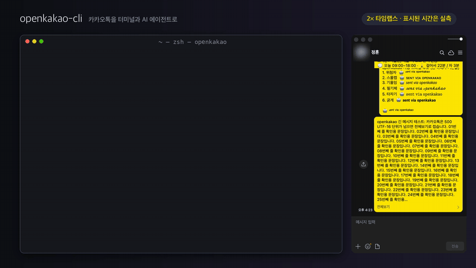

# OpenKakao

**A macOS CLI that hands your KakaoTalk to an AI agent. Every message it sends is read back from the screen.**

[](https://github.com/JungHoonGhae/openkakao-cli/actions/workflows/openkakao-cli-ci.yml)
[](https://github.com/JungHoonGhae/openkakao-cli/releases/latest)
[](#install)
[](LICENSE)

[한국어](README.md) · **English**

`openkakao-cli` drives the official KakaoTalk Mac app you are already signed in to, through macOS Accessibility, to read, send and tidy up chats. No extra login, no protocol traffic, no database decryption.



```bash
openkakao-cli ax-read "Family" -n 20
openkakao-cli local-send "Family" "I'll call after the meeting"
openkakao-cli local-send-file "Mina" ~/Downloads/quote.pdf
openkakao-cli ax-search "Mina" "contract"
```

That is reading recent messages, sending, sending a file and searching a chat's whole history.

## Highlights

- **Only the official, already-signed-in app.** It first checks that the running KakaoTalk carries Kakao's official code signature, then reads and presses only what that app exposes through Accessibility. It never signs in as another device, never talks to Kakao's servers directly and never unlocks the local chat database.
- **Never takes your keyboard or mouse.** The default paths never bring KakaoTalk to the front and never send keystrokes, so whoever is at that Mac keeps working. A KakaoTalk window on another desktop (Space) is read and sent text where it is.
- **Every send is checked on screen.** A send counts only when the new bubble appears, the upload finishes and shows 공유 (share), the bubble shows 수정됨 (edited), or the reaction count goes up. If it cannot confirm, it says so and stops.
- **Fast.** It reads the app's UI structure directly instead of capturing the screen and matching images. Sending a text and confirming it took 0.5 to 0.7 s, and reading the last 20 messages 0.3 to 0.5 s (Mac Studio, KakaoTalk 26.8, releases 1.14 to 1.18, [measurements](bench/results.csv)).

## Install

You need macOS with KakaoTalk for Mac running and signed in.

```bash
curl -fsSL https://raw.githubusercontent.com/JungHoonGhae/openkakao-cli/main/install.sh | sh
openkakao-cli init
```

The [install script](install.sh) downloads the latest release binary, checks its checksum and puts it in `~/.local/bin`. If that folder is not on your PATH, it prints the line to add. Run the same line again to update.

`init` checks Accessibility and sign-in, registers the chats you want to send to, and can install the agent skill. It is safe to re-run. To use it over SSH, grant Accessibility to `/usr/libexec/sshd-keygen-wrapper` on that Mac once.

Homebrew works too. `brew trust` is required since Homebrew 7.

```bash
brew tap JungHoonGhae/openkakao
brew trust --formula junghoonghae/openkakao/openkakao-cli
brew install openkakao-cli
openkakao-cli init
```

## Quick start

```bash
# Read-only checks
openkakao-cli doctor

# Unread chats (about 20 s with hundreds of chats)
openkakao-cli ax-chats --unread

# Read recent messages; opens the chat first if its window is closed
openkakao-cli ax-read "Family" -n 20 --open-if-needed

# Preview what would go out, then send once you confirm which chat
openkakao-cli local-send "Family" "I'll call after the meeting" --dry-run
openkakao-cli local-send "Family" "I'll call after the meeting"
```

- Write a chat's name exactly as KakaoTalk shows it. When several chats share a name, it waits until you pick one.
- A chat opened with `--open-if-needed` is marked as read.

With an agent, install the [skill](#for-ai-agents) and just say what you want.

> Sum up the KakaoTalk messages since lunch. In the family chat, reply in my tone: "I'll call after the meeting."

> Mark the unread channels that hold only ads as read. Tell me about order and payment notices first.

> Find "contract" in the whole history of my chat with Mina.

> Tell me whose birthday it is today, and draft the greetings to send.

## What it can do

| Goal | Commands |
|---|---|
| Read a chat, go through unread chats | `ax-read`, `ax-chats --unread` |
| Send text, photos and files | `local-send`, `local-send-photo`, `local-send-file` |
| Reply, edit, delete, react (experimental) | `local-reply`, `local-edit`, `local-delete`, `local-react` |
| Notice incoming messages | `notif-watch` |
| Back up and search a chat's history | `ax-export`, `ax-search` |
| Clear the unread backlog: mark as read, block ad channels, leave chats | `local-mark-read`, `ax-friend --block`, `local-leave-chat` |
| Find friends, birthdays, memos, open a 1:1 chat | `ax-friends`, `ax-friends --birthdays`, `ax-friend` |
| Write in your own tone, chat by chat | `style` |
| Let the agent propose and a person approve | `safe-send` |
| Check, set up, sign a signed-out KakaoTalk back in | `doctor`, `init`, `ax-login` |

Every command takes `--json` and `--help`. Options and error codes for each command are in [SKILL.md](skills/openkakao-cli/SKILL.md).

## For AI agents

```bash
npx skills add JungHoonGhae/openkakao-cli
```

- **The skill updates with the CLI.** The [skill](skills/openkakao-cli/SKILL.md) lives in this repository and ships with every CLI release. `openkakao-cli init` can install it too. Any agent that runs shell commands works: Claude Code, Codex, OpenClaw, Cursor.
- **Failures are JSON too.** A failed command prints one JSON object like the one below and exits with code 1. `disposition` tells whether a retry is safe.
- **It can wait for new messages.** `openkakao-cli --json notif-watch` prints one line per incoming message. It reads macOS notifications, so the chat window can stay closed.
- **You can be away.** SSH from your phone into your Mac and hand the work to your agent. Whoever is working at that Mac keeps their screen.

```json
{
  "error": {
    "code": "chat_window_not_open",
    "message": "…",
    "fix": "…",
    "disposition": { "delivery": "not_delivered", "retry": "safe" }
  }
}
```

## Safeguards

- **You choose where it may send.** Chats you register during setup get messages right away. Any other chat needs Touch ID (or the login password) on that Mac for every send.
- **It shows which chat before it sends.** Member count, recent senders and last activity, plus the three newest messages when the chat is not registered.
- **Your agent can be limited to proposals.** A message proposed with `safe-send` goes out only after a person types its 12-character code in a terminal.
- **No guessing.** When several chats share a name it waits until you pick one, and a half-written draft in the composer is never cleared without your say.
- **Nothing unverified is sent again.** There are no automatic retries, so a message never goes out twice.
- **What cannot be undone is stricter.** Leaving a chat needs Touch ID on that Mac, and only channels can be blocked. A person is never blocked.
- **Tool-sent messages are marked.** A small signature line and an invisible watermark end each one, so they stay recognisable. You can send without the signature if you prefer.

The list of registered chats is a config file your account can write, so shells and agents on this Mac can send to those chats without a prompt. Register only chats that are fine to send to. The option that skips the Touch ID check works only where a person allowed it in the config file.

## Good to know

- **macOS only.** KakaoTalk for Mac must be running and signed in. If it gets signed out, `ax-login` signs it back in with the password you saved in the keychain.
- **`ax-read` reads only the recent messages drawn in the chat window.** For the whole history, use `ax-export` or `ax-search`.
- **Reply, edit, delete and react are experimental.** They were built and measured on KakaoTalk 26.8 and 26.9. When an update changes the screen, they stop with an error code instead of guessing.
- **A chat window on another desktop cannot take files, photos or exports.** Text, replies, edits and deletes work there.
- **The old server-login and LOCO commands are deprecated.** Commands such as `login`, `send`, `read` and `watch` do not work on recent KakaoTalk builds. The research is kept in the [protocol docs](https://openkakao.vercel.app/docs/protocol/overview).

## How it compares

People automate KakaoTalk in five broad ways, and openkakao is the one that drives the official app through Accessibility. The table only carries what each project states in its own README and docs (checked 2026-11-07). A cell their docs do not settle is marked —.

<details>
<summary>Show the comparison table</summary>

| Approach | Project | Own login | Reads local DB | Takes keyboard/mouse | Sends | Verifies send | Platform |
|---|---|---|---|---|---|---|---|
| Protocol (LOCO) client that signs in as another device | [node-kakao](https://github.com/storycraft/node-kakao) | Yes, registers a sub-device | No | No | Yes | — | Node.js library, marked not maintained |
| | [KiwiTalk](https://github.com/KiwiTalk/KiwiTalk) | Yes, its own login screen | No | No | — | — | Desktop app for OSes without KakaoTalk (Ubuntu, Arch…) |
| Reads the local encrypted DB | [kakaocli](https://github.com/silver-flight-group/kakaocli) | No, auto-signs in the official app | Yes, read-only (Full Disk Access) | — | Yes, via Accessibility | — | macOS 14+ |
| Mouse/keyboard macro on the screen | [kakaotalk_automation](https://github.com/rainmankim/kakaotalk_automation) (pyautogui) | No, the official app | No | Yes, clicks and types where screen images match | Yes | — | — |
| Android bot bridge | [remote-kakao](https://github.com/remote-kakao/core) | No, KakaoTalk on the phone | — | — | Yes | — | Android phone (KakaoTalk, MessengerBot) + Node.js |
| Accessibility on the official app | [kmsg](https://github.com/channprj/kmsg) | No | No | Regular commands may activate KakaoTalk (not `--background-safe` reads) | Yes, text and images | — | macOS 13+ |
| | [katok](https://github.com/sunghyun-k/katok-cli) | No | No | — | Yes, text | — | macOS 13+ |
| | **openkakao-cli** | No | No | No (default paths) | Yes: text, photos, files, replies, edits, deletes, reactions | Yes, reads the result back from the screen | macOS |

</details>

kakaocli is a hybrid: it reads through the database and sends through Accessibility. openkakao's Accessibility automation also started from kakaocli (see [Contributing](#contributing)).

## Docs

- [SKILL.md](skills/openkakao-cli/SKILL.md): every command and option, error codes and their fixes
- [Send and read reference](https://openkakao.vercel.app/docs/cli/local-send): `local-send`, `local-send-photo`, `ax-read`
- [CHANGELOG](CHANGELOG.md): what changed in each version

If something is stuck, start with `openkakao-cli doctor` (read-only).

## Contributing

Bug reports and PRs are welcome; please read [CONTRIBUTING.md](CONTRIBUTING.md) first. Development builds use `cargo build --release`.

- Contributors: [@twoimo](https://github.com/twoimo) ([#36](https://github.com/JungHoonGhae/openkakao-cli/pull/36)), [@e-jung](https://github.com/e-jung) ([#51](https://github.com/JungHoonGhae/openkakao-cli/pull/51), [#57](https://github.com/JungHoonGhae/openkakao-cli/pull/57)), [@NetRiceCake](https://github.com/NetRiceCake) ([#60](https://github.com/JungHoonGhae/openkakao-cli/pull/60)), [@zinoopark](https://github.com/zinoopark) ([#62](https://github.com/JungHoonGhae/openkakao-cli/pull/62))
- `local-send`'s Accessibility automation was ported to Rust from [kakaocli](https://github.com/silver-flight-group/kakaocli) (MIT). Its `CGEventPostToPid` event delivery follows [Peekaboo](https://github.com/openclaw/Peekaboo) (MIT), and the lookup of windows on other desktops follows [AltTab](https://github.com/lwouis/alt-tab-macos).

If this project helps you, you can support it on [Buy Me a Coffee](https://www.buymeacoffee.com/lucas.ghae).

## License

[MIT](LICENSE). Unofficial project; not affiliated with or endorsed by Kakao Corp.
