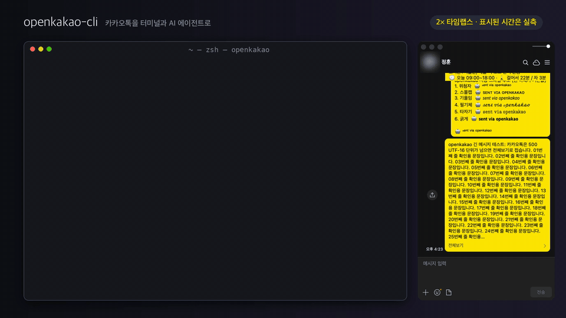

<div align="center">
  <p><b>한국어</b> · <a href="README.en.md">English</a></p>
  <h1>OpenKakao</h1>
  <p><b>카카오톡을 터미널과 AI 에이전트에서. 0.5초 안에 보내고, 보낸 것까지 확인합니다.</b></p>
  <p>이미 로그인된 공식 카카오톡 앱을 macOS 손쉬운 사용(Accessibility)으로 직접 움직입니다.<br />
  서버 로그인도, 프로토콜 통신도, DB 복호화도 없습니다. 실행 파일은 <code>openkakao-cli</code>입니다.</p>
  <p>
    <a href="https://github.com/JungHoonGhae/openkakao-cli/releases"></a>
    <a href="#설치"></a>
    
    <a href="https://www.rust-lang.org/"></a>
    <a href="LICENSE"></a>
    <a href="https://github.com/JungHoonGhae/openkakao-cli/stargazers"></a>
  </p>
  <p>
    <a href="#설치"><b>설치</b></a> ·
    <a href="#성능"><b>성능</b></a> ·
    <a href="#기능"><b>기능</b></a> ·
    <a href="#에이전트-연동"><b>에이전트</b></a> ·
    <a href="#안전-모델"><b>안전 모델</b></a> ·
    <a href="https://openkakao.vercel.app/"><b>문서</b></a>
  </p>
  <table>
    <tr>
      <td align="center"><b>0.30초</b><br /><sub>최근 메시지 20개 읽기</sub></td>
      <td align="center"><b>0.47초</b><br /><sub>보내고 말풍선까지 확인</sub></td>
      <td align="center"><b>약 90배</b><br /><sub>v1.9보다 빠름</sub></td>
      <td align="center"><b>9개</b><br /><sub>1.14에서 새로 생긴 명령</sub></td>
    </tr>
  </table>
  
</div>

## 새 소식

1.14에서만 새 명령이 9개 늘었습니다. 전체 기록은 [CHANGELOG](CHANGELOG.md)에 있습니다.

- **1.14** 대화 백업·검색(`ax-export`, `ax-search`), 안 읽은 방 정리(`ax-chats --unread`, `local-mark-read`), 친구 메모(`ax-friend`), 리액션, 방 이름 바꾸기, 방별 말투(`style`), 접힌 메시지 읽기(`--expand`)
- **1.13** 보내기 전 방 확인 카드, 500자가 넘어 접힌 메시지도 전송 확인, 새 서명 줄 `⌞ₛₑₙₜ ᵥᵢₐ ₒₚₑₙₖₐₖₐₒ`
- **1.12** 메시지 삭제(`local-delete`), 사진·파일은 업로드가 끝나야 `sent`, 에이전트 스킬을 CLI와 같은 릴리스로 배포

## 설치

```bash
brew tap JungHoonGhae/openkakao
brew trust --formula junghoonghae/openkakao/openkakao-cli   # Homebrew 7부터 서드파티 tap은 신뢰 등록이 필요합니다
brew install openkakao-cli
```

이제 `init`을 한 번 실행하면 끝입니다. 손쉬운 사용 권한과 로그인 상태를 점검하고, 메시지를 보낼 방을 등록하고, 원하면 에이전트 스킬까지 설치합니다. 여러 번 실행해도 안전합니다.

```bash
openkakao-cli init
openkakao-cli ax-read "방 이름" -n 20              # 최근 메시지 읽기
openkakao-cli local-send "방 이름" "안녕하세요" -y   # 보내기
```

카카오톡이 실행·로그인돼 있고 터미널에 손쉬운 사용 권한이 있으면 됩니다. 방은 채팅 창 제목과 똑같은 이름으로 찾습니다(나와의 채팅은 내 표시 이름). 소스에서 빌드하려면 `cargo install --path .`를 씁니다(Rust 1.95는 `rust-toolchain.toml`이 알아서 고릅니다).

## 성능

같은 Mac Studio, 카카오톡 26.8에서 잰 값입니다(v1.14.0은 2026-11-07). 명령 시작부터 끝까지 걸린 시간이고, 쓰기 명령은 결과 확인까지 포함합니다.

| 작업 | 명령 | v1.9 | v1.14.0 |
|---|---|--:|--:|
| 열린 방 최근 메시지 20개 읽기 | `ax-read` | 26.8초 | **0.30초** (약 90배) |
| 접힌 긴 메시지까지 읽기 | `ax-read --expand` | — | **0.69초** |
| 보내고 새 말풍선까지 확인 | `local-send` | 44초 | **0.47초** (약 93배) |
| 보낸 메시지 고치고 `수정됨`까지 확인 | `local-edit` | — | **2.0초** |
| 나에게서만 삭제 | `local-delete --for-me` | — | **3.2초** |
| 대화 전체를 CSV로 백업 | `ax-export` | — | **4.2초** |
| 안 읽은 방 추리기 (채팅 목록 약 670개) | `ax-chats --unread` | — | **12.4초** |

—는 v1.9에 없던 명령입니다. 창이 닫힌 방은 `--open-if-needed`가 카카오톡 검색으로 찾아 엽니다(v1.10 6.5초 → v1.11 3.2초, 140개 방이 검색된 최악 조건). 이 표는 릴리스마다 [`bench/run.sh`](bench/run.sh)로 나와의 채팅에서 다시 재서 [`bench/results.csv`](bench/results.csv)에 쌓습니다.

## 기능

기본 경로는 모두 포커스를 뺏지 않습니다. 카카오톡을 앞으로 띄우지 않고 키보드·마우스 입력도 흉내 내지 않으니, 그 Mac에서 하던 일을 그대로 이어 갈 수 있습니다.

### 보내고 확인하기

```bash
openkakao-cli local-send "방 이름" $'첫 줄\n둘째 줄' -y                  # 줄바꿈도 말풍선 하나로
openkakao-cli local-send-file "방 이름" ./보고서.pdf -y                  # docx·xlsx·pdf·zip 등, 기본 300MB까지
openkakao-cli local-send-photo "방 이름" ./사진.jpg -y
openkakao-cli local-reply "방 이름" "확인했습니다" --to-last -y
openkakao-cli local-edit "방 이름" --match "보낸 원문" "고친 내용" -y
openkakao-cli local-delete "방 이름" --match "보낸 원문" --for-everyone -y   # 또는 --for-me
openkakao-cli local-react "방 이름" --to-last --reaction 엄지척 -y
```

텍스트는 새 말풍선이, 파일과 사진은 업로드 완료(`공유` 버튼)가, 수정은 `수정됨` 표시가 보여야 성공입니다. 창이 닫힌 방은 `--open-if-needed`, 미리보기는 `--dry-run`을 붙입니다. 답장·수정·삭제·리액션은 실험 기능이고, `--match`에는 말풍선의 전체 텍스트를 그대로 넣습니다.

### 읽고 받기

```bash
openkakao-cli ax-read "방 이름" -n 20 --json   # 보낸 사람, 시각, 내가 보낸 메시지인지
openkakao-cli ax-read "방 이름" --expand       # '전체보기'로 접힌 메시지도 통째로
openkakao-cli notif-watch --json               # 새 메시지 감지: 창이 닫혀 있어도, 내가 보낸 건 빼고
openkakao-cli notif-watch --durable --json     # 로컬 인박스에 먼저 저장해 재시작해도 놓치지 않음
```

`notif-watch`는 macOS 알림 센터를 읽어 `--hook-cmd`나 `--webhook-url`로 넘깁니다. 알림이 뜨지 않는 음소거 방까지 잡으려면 채팅 목록을 보는 `ax-watch`를 같이 씁니다.

### 받은 메시지 정리

```bash
openkakao-cli ax-chats --unread                      # 안 읽은 방: 안읽음 수, 인원, 시각, 미리보기
openkakao-cli local-mark-read "광고 채널" "쇼핑 채널"   # 방을 열지 않고 카카오톡의 '읽음 처리'
```

이름이 정확히 같은 방만 처리하고, 안읽음 배지가 사라져야 성공으로 칩니다. 실측으로 채널 96개, 메시지 328개를 두 번 만에 정리했습니다.

### 백업과 검색

```bash
openkakao-cli ax-export "방 이름" --output ~/backup/   # 카카오톡의 '텍스트 파일로 저장'으로 전체 대화를 CSV로
openkakao-cli ax-search "방 이름" "계약서"              # 전체 기록에서 찾기, --from으로 예전 백업 검색
```

CSV는 `Date, User, Message` 세 열입니다. `ax-search`는 내보내고 찾은 뒤 파일을 지우고, `--keep`을 주면 남겨 둡니다.

### 친구와 방

```bash
openkakao-cli ax-friends "민수"                        # 친구 탭 검색: 이름, 상태 메시지
openkakao-cli ax-friend "김민수"                        # 나만 보는 메모와 내가 붙인 이름
openkakao-cli ax-friend "김민수" --memo "11월 미팅 담당" -y
openkakao-cli local-rename-chat "방 이름" "새 이름" -y    # 이 계정에만 보이는 방 이름
```

이름 바꾸기(`local-rename-chat`, `ax-friend --rename`)는 Touch ID를 거치고, 화이트리스트에 있는 이름으로는 바꾸지 않습니다.

### 설정과 복구

```bash
openkakao-cli init --allow-chat "방 이름"             # 보낼 방 등록 (정확한 이름만)
openkakao-cli doctor --chat "방 이름"                 # 열린 채팅 창 점검, 아무것도 누르지 않음
openkakao-cli init --all-spaces                     # 어느 데스크탑에서든 카카오톡 창을 찾게 (Dock 한 번 재시작)
security add-generic-password -s openkakao.kakaotalk -a you@example.com -w   # 비밀번호를 키체인에 (최초 1회)
openkakao-cli ax-login --account you@example.com    # 다른 기기 로그인으로 로그아웃되면 원격으로 다시 로그인
```

## 에이전트 연동

<div align="center">
<table>
  <tr>
    <td align="center"><strong>Works with</strong></td>
    <td align="center"><br /><sub>OpenClaw</sub></td>
    <td align="center"><br /><sub>Claude Code</sub></td>
    <td align="center"><br /><sub>Codex</sub></td>
    <td align="center"><br /><sub>Cursor</sub></td>
    <td align="center"><br /><sub>Bash</sub></td>
    <td align="center"><br /><sub>HTTP</sub></td>
  </tr>
</table>
</div>

```bash
npx skills add JungHoonGhae/openkakao-cli   # 또는: openkakao-cli init --skill claude|codex|all
```

스킬은 이 저장소의 [`skills/openkakao-cli/`](skills/openkakao-cli/)에 있어 CLI와 같은 릴리스로 갱신됩니다.

- **구조화된 결과.** `--json`을 붙이면 실패도 `{"error": {"code", "message", "fix", "disposition"}}`로 나옵니다. `disposition.retry`가 `safe`일 때만 다시 실행해도 두 번 보내지 않습니다.
- **방 확인 카드.** 보내기·답장·수정·삭제 전에 인원수, 최근 보낸 사람, 마지막 대화 시각을 보여 주고, 화이트리스트 밖의 방이면 최근 메시지 3개도 함께 보여 줍니다.
- **방마다 다른 말투.** `style "방 이름" --learn`은 그 방에서 내가 쓴 최근 메시지 200개를 이 Mac에만(권한 0600) 보관합니다. 에이전트는 이걸 보고 그 방의 말투를 따라 씁니다.
- **사람이 승인하는 전송.** `safe-send propose`는 제안만 저장하고 절대 보내지 않습니다. 사람이 대화형 터미널에서 12자리 코드를 입력해야(`safe-send approve`) 나갑니다.
- **도구가 보낸 메시지 표시.** 메시지 끝의 서명 줄과 보이지 않는 워터마크로 알아보고, `ax-read --json`은 `via_openkakao`로 표시합니다. `--no-prefix`를 주면 입력한 그대로 보냅니다.
- **SSH.** 카카오톡이 도는 Mac에 SSH로 붙어서도 씁니다. 그 Mac에서 `/usr/libexec/sshd-keygen-wrapper`에 손쉬운 사용 권한을 한 번 주면 됩니다.

```bash
openkakao-cli style "방 이름" --json                              # learned / not_asked / declined
openkakao-cli safe-send propose "방 이름" "검토할 메시지" --json   # 보내지 않고 제안만 저장
openkakao-cli safe-send approve <intent_id>                       # 사람이 터미널에서 승인
```

## 안전 모델

이미 로그인된 공식 카카오톡 앱만 움직입니다. 실행 중인 앱이 카카오톡 공식 코드서명을 가졌는지 먼저 확인하고, 서버 로그인·프로토콜 통신·DB 복호화는 하지 않습니다.

- **화이트리스트 방은 바로, 나머지는 Touch ID.** `init --allow-chat`으로 등록한 방은 사람이 미리 승인한 것으로 보고 바로 보냅니다. 그 밖의 방은 `⚠ NOT in [safety] allowed_send_chats`로 표시하고, 보낼 때마다 Touch ID(또는 로그인 암호)를 거칩니다.
- **추측해서 보내지 않습니다.** 이름이 같은 방이 여럿이면 `--pick N`으로 고를 때까지 멈추고, 이때도 Touch ID를 묻습니다. 입력창에 남은 초안은 `--discard-draft`를 줄 때만 지우며 지우기 전에 내용을 보여 줍니다. 같은 텍스트의 말풍선이 둘이면 손대지 않습니다.
- **확인하지 못한 건 다시 보내지 않습니다.** 결과를 확인하지 못하면 `delivery_uncertain`으로 알리고 끝냅니다. 자동 재시도는 없습니다.

```toml
# ~/.config/openkakao/config.toml (init이 써 줍니다)
[safety]
allow_ax_send = true
allowed_send_chats = ["내 이름", "가족"]
```

화이트리스트는 내 계정이 쓸 수 있는 파일이라, 이 Mac의 셸이나 에이전트도 등록된 방에는 바로 보낼 수 있습니다. 정말 보내도 되는 방만 넣으세요.

## 문제 해결

`--json` 실패에는 `code`와 함께 `fix`가 들어 있습니다. 먼저 `openkakao-cli doctor`(읽기 전용)로 점검해 보세요.

| 코드 | 이럴 때 | 이렇게 |
|---|---|---|
| `accessibility_not_granted` | 실행한 앱에 손쉬운 사용 권한이 없음 | 시스템 설정 → 개인정보 보호 및 보안 → 손쉬운 사용에서 터미널을 켭니다 (SSH는 `/usr/libexec/sshd-keygen-wrapper`) |
| `chat_window_not_open` | 그 제목의 채팅 창이 열려 있지 않음 | `--open-if-needed`를 붙이거나 채팅 창을 한 번 열어 둡니다 |
| `chat_not_found` | 이름이 맞는 방이 없음 | 띄어쓰기·대소문자만 다른 방은 마지막 메시지와 함께 알려 줍니다. 확인한 뒤 그 정확한 이름으로 다시 실행 |
| `chat_ambiguous` | 같은 이름의 방이 여럿 | 번호가 붙은 후보 중에서 `--pick N`으로 고릅니다 (Touch ID) |
| `composer_busy` | 입력창에 초안이나 답장·수정 배너가 있음 | `--discard-draft`(지우기 전에 출력)를 붙이거나 카카오톡에서 직접 정리 |
| `delivery_uncertain` | 보냈을 수도 있지만 확인하지 못함 | `ax-read`로 먼저 확인합니다. 그냥 다시 보내면 두 번 갑니다 |
| `delete_unavailable` | 카카오톡이 그 삭제를 허용하지 않음 (나와의 채팅, 남의 메시지, 24시간 지난 메시지의 전체 삭제) | 그대로 두거나, 원하면 `--for-me`로 이 Mac에서만 지웁니다 |
| `user_active` | 카카오톡 메뉴가 이미 열려 있거나 커서가 메뉴 위에 있음 | 다른 곳을 클릭해 메뉴를 닫고 다시 실행 (Esc는 누르지 않습니다. 카카오톡이 창을 닫습니다) |

나머지 코드는 [`SKILL.md`](skills/openkakao-cli/SKILL.md#reading-results)에 정리돼 있습니다.

## 문서

**[openkakao.vercel.app](https://openkakao.vercel.app/)** · [빠른 시작](https://openkakao.vercel.app/docs/getting-started/quickstart/) · [CLI 레퍼런스](https://openkakao.vercel.app/docs/cli/overview/) · [local-send](https://openkakao.vercel.app/docs/cli/local-send/) · [에이전트 워크플로](https://openkakao.vercel.app/docs/automation/llm-agent-workflows/)

<details>
<summary>예전 서버 로그인·LOCO 명령 (지원 중단)</summary>

`login`, `chats`, `read`, `send`, `watch` 같은 서버 로그인·LOCO 기반 명령과 로컬 DB 명령(`local-chats`, `local-read`, `local-search`)은 최근 카카오톡 빌드에서 동작하지 않아 지원을 중단했습니다. 반복해서 시도하지 말고 위의 `ax-*`, `local-*` 명령을 쓰세요. 분석 기록은 [프로토콜 문서](https://openkakao.vercel.app/docs/protocol/overview/)와 [Android 26.7.1 LOCO 정적 분석](docs/research/android-apk-26.7.1.md)에 남아 있습니다.

</details>

## 기여

버그 제보와 PR 환영합니다. [CONTRIBUTING.md](CONTRIBUTING.md)를 먼저 읽어 주세요. 개발 빌드는 `cargo build --release`입니다.

- 기여해 주신 분들: [@twoimo](https://github.com/twoimo) ([#36](https://github.com/JungHoonGhae/openkakao-cli/pull/36)), [@e-jung](https://github.com/e-jung) ([#51](https://github.com/JungHoonGhae/openkakao-cli/pull/51), [#57](https://github.com/JungHoonGhae/openkakao-cli/pull/57)), [@NetRiceCake](https://github.com/NetRiceCake) ([#60](https://github.com/JungHoonGhae/openkakao-cli/pull/60)), [@zinoopark](https://github.com/zinoopark) ([#62](https://github.com/JungHoonGhae/openkakao-cli/pull/62))
- `local-send`의 Accessibility 조작 로직은 [kakaocli](https://github.com/silver-flight-group/kakaocli)(MIT)에서 Rust로 옮겨 왔고, `CGEventPostToPid`로 이벤트를 직접 전달하는 방식은 [Peekaboo](https://github.com/steipete/Peekaboo)(MIT)를 참고했습니다.

도움이 되셨다면 응원해 주세요.

<a href="https://www.buymeacoffee.com/lucas.ghae"></a>

MIT License

---

<sub>카카오(Kakao Corp.)와 제휴하거나 보증받지 않은 비공식 프로젝트입니다.</sub>
